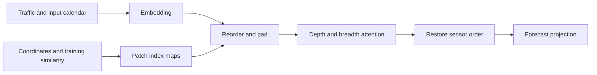

# PatchSTG architecture review

Reviewed 2026-11-11. Subsequent approved implementation and CPU checks complete;
see [implementation record](../patchstg_implementation.md). No training yet.
Target: adapted SD evaluation, not an official reproduction.

## Intuition and paper mapping

PatchSTG reduces the number of sensor pairs involved in spatial attention by
organizing sensors into balanced spatial patches. Paper sections 4.1–4.4 map to
embedding, irregular spatial patching, dual attention and prediction projection.
Spatial organization preserves individual sensor representations rather than
replacing each patch with one pooled token. See [paper v2](https://arxiv.org/html/2412.09972v2).

## Concrete SD reference and shapes

The [pinned SD config](https://github.com/LMissher/PatchSTG/blob/8b298b230227a304a082e05241c69dca3740a73d/config/SD.conf)
uses H=F=12, temporal patch size 12, one temporal patch, five layers, and embedding
widths 64/64/32/32 for signal/node/day-slot/weekday. Total D=192. Leaf depth 9,
capacity 2, merge factor 32 imply 512 leaves, 1,024 padded positions, P=16 merged
patches and S=64 positions per patch. Batch 16 and 50 epochs are author settings,
not promises for our GPU or a frozen project training budget.

Following the [model reference](https://github.com/LMissher/PatchSTG/blob/8b298b230227a304a082e05241c69dca3740a73d/models/model.py):

| Stage | Shape |
| --- | --- |
| Traffic; expanded integer calendar | (B,12,716,1); (B,12,716,2) |
| Temporal signal projection plus embeddings | (B,1,716,192) |
| Gather and reshape | (B,1,16,64,192) |
| Depth attention sequence / breadth sequence | 64 positions / 16 patches |
| Restore original sensors; decode | (B,1,716,192) → (B,12,716,1) |

Each block uses one attention head, pre-normalization, residual connections,
GELU MLPs with width ratio 1, and 0.1 attention/projection/MLP dropout. The signal
projection also consumes normalized calendar scalars. Output is normalized flow;
our adapter should invert the scaler before original-unit loss/evaluation.
No future traffic or future calendar is required by this forward path.

## Spatial preparation and discrepancy

The [pinned utilities](https://github.com/LMissher/PatchSTG/blob/8b298b230227a304a082e05241c69dca3740a73d/lib/utils.py)
recursively split coordinates, pad leaves using similarity, and produce gather/
restore maps. Similarity comes from mean normalized training segments and cosine
similarity, followed by an exponential transform. The segment length is hard-coded
to 288; at SD cadence that is three days, not one day. For exact code behavior,
21024 training frames provide 73 full segments. A cadence-aware 96-step profile
would be a deliberate adaptation, not a silent correction.

Recommendation for the first reference-aligned implementation: preserve the
288-step behavior and label it. Use explicit training-only inputs and new,
provenance-checked cache identity. Test zero norms, zero similarity variance,
index uniqueness/restoration and deterministic tie handling before trusting maps.
No maps were generated during the review; the subsequent approved implementation
now builds provenance-checked maps as recorded in the implementation guide.

## Fidelity and implementation choices

The paper's SD embedding dimensions differ from the config. Use the config as
the initial code-aligned architecture and record the discrepancy; do not claim
paper-exact dimensions. The author training entry point inverse-transforms output
and uses AdamW; its scheduler milestones differ in wording from the paper.
See [main.py](https://github.com/LMissher/PatchSTG/blob/main/main.py).

The subsequent implementation uses ordinary PyTorch attention/MLP components
with fixed-weight numerical checks, avoiding a timm dependency. This is an independently written
adapted implementation. Preserve checkpoint behavior, dropout and normalization
semantics; test CPU/CUDA index buffers and state-dict round trips.

PatchSTG's [software license](https://github.com/LMissher/PatchSTG/blob/main/LICENSE)
is MIT, copyright 2024 LMissher. Any copied/adapted source must retain its notices.
Dataset terms are a separate unresolved issue. See [implementation plan](../model_implementation_plan.md).
